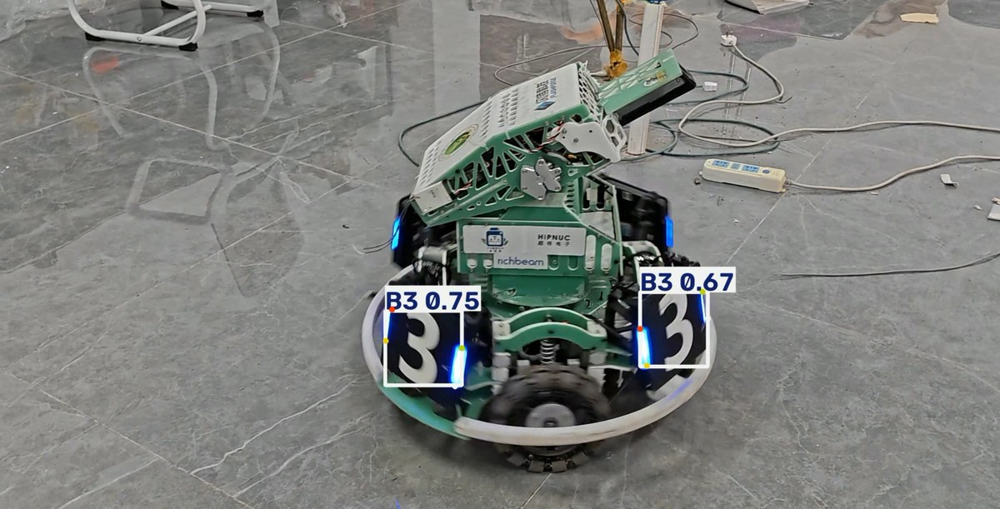
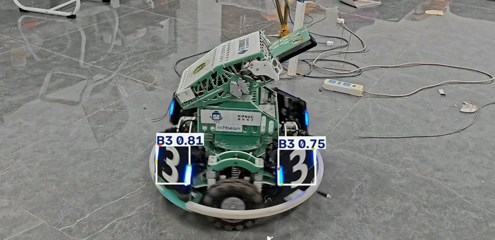
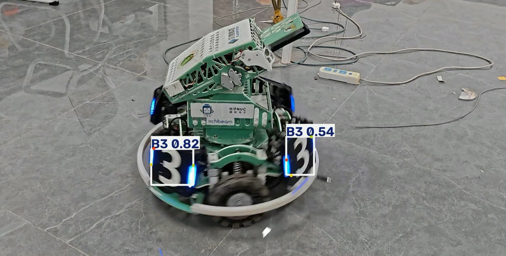

# YOLO 姿态估计装甲板推理与模型导出对比

基于 Ultralytics YOLO26n-pose 的装甲板检测与关键点提取项目，并将 `.pt` 模型导出为 `.onnx`、`.torchscript` 格式，对比三者的推理速度与输出一致性。

## 1. 项目功能

基于 YOLO 姿态估计模型，实现对视频中装甲板的检测与关键点提取。本次实验在此基础上，将原始 `.pt` 模型导出为 `.onnx` 与 `.torchscript` 格式，并对比三者的推理表现。

| 项目 | 说明 |
| :--- | :--- |
| 模型 | YOLO26n-pose（Ultralytics 8.4.177） |
| 任务 | pose：6 类装甲板，每个目标 4 个关键点 |
| 类别 | `B1`、`B2`、`B3`、`R1`、`R2`、`R3` |
| 模型输入 | 640 × 640 |
| 测试视频 | 1920 × 1080，30 FPS，620 帧（`data/test_video.mp4`，体积较大未入库） |

## 2. 运行环境

- Python 版本：Python 3.10.8
- 主要依赖：`torch`、`ultralytics`、`opencv-python`、`numpy`、`onnx`、`onnxruntime`（GPU 环境为 `onnxruntime-gpu`）、`onnxslim`
- 实验推理设备：NVIDIA RTX 5070 Laptop GPU

> **复现 GPU 结果前请确认：**
> 1. RTX 5070 需要 CUDA 12.8+ 与 PyTorch 2.7+；
> 2. ONNX 侧需要安装 `onnxruntime-gpu`，否则会退回 CPU 推理，和 GPU 上的 `.pt` 对比不公平；
> 3. Windows 上直接 `pip install torch` 默认安装的是 CPU 版，GPU 版请按 [PyTorch 官网](https://pytorch.org/get-started/locally/)给出的命令安装。

## 3. 权重准备

把训练好的 `best.pt` 放到 `weights/` 目录下，脚本按以下路径读取：

| 文件 | 说明 |
| :--- | :--- |
| `weights/best.pt` | 原始 PyTorch 权重 |
| `weights/best.onnx` | 由 `export.py` 导出 |
| `weights/best.torchscript` | 由 `export.py` 导出 |

三个权重文件均已提交到仓库。测试视频 `data/test_video.mp4` 因体积原因未提交，需要自行准备并放到 `data/` 目录下。

## 4. 模型导出说明

使用 Ultralytics 官方 API 进行导出（代码见 `export.py`）：

- **ONNX**：设置 `simplify=True`，opset 18，静态输入 `1×3×640×640`，输出 `1×18×8400`，通用性强。
- **TorchScript**：采用默认 Trace 方式导出，适合 C++ 等无 Python 环境部署。

```bash
python export.py
```

## 5. 安装与运行

1. 安装依赖：

```bash
pip install -r requirements.txt
```

2. 导出模型（仓库已包含导出结果，可跳过）：

```bash
python export.py
```

3. 运行推理与对比测试：

```bash
python compare_inference.py
```

4. 结果保存位置：
   - 对比视频：`results/result_pt.mp4`、`results/result_onnx.mp4`、`results/result_torchscript.mp4`
   - 统计结果：`results/metrics.json`
   - 对比截图：`assets/`

## 6. 模型对比结果

测试数据：`data/test_video.mp4`；视频分辨率 1920 × 1080，模型输入 640 × 640。

### 原始模型 (.pt) 效果



### ONNX 模型效果



### TorchScript 模型效果



| 对比项目 | 原始 .pt 模型 | ONNX 模型 | TorchScript 模型 |
| :--- | :--- | :--- | :--- |
| 模型文件大小 | 5.61 MB | 9.72 MB | 9.95 MB |
| 平均推理耗时 | 32.76 ms | 36.13 ms | 53.74 ms |
| 检测目标数量 | 2 | 2 | 2 |

### 6.1 实验现象

- **问题 1：第一次运行时，ONNX 格式慢于 PT 格式，很奇怪。**
  - **解决过程**：经过多次测试以后，取平均值得到 ONNX 依然略慢于 PT，TorchScript 最慢。

### 6.2 数值一致性

脚本会以 `.pt` 为基准，逐帧比较 ONNX / TorchScript 的检测框与关键点坐标，结果写入 `results/metrics.json`：

- ONNX 与 TorchScript 的输出几乎逐字节一致，两者生成的对比视频 SHA256 相同；
- 与 `.pt` 相比存在亚像素级差异，检测框偏差通常在 1 px 以内；
- 个别帧中目标置信度非常接近 0.25 阈值，会出现三种模型检出数量相差 1 个的情况。

## 7. 实验结论与分析

1. **速度差异**：在本次 GPU 测试环境下，ONNX 的推理速度略慢于原始 PyTorch 模型，TorchScript 速度最慢。
2. **原因分析**：桌面 GPU 上 PyTorch 技术更成熟，而 ONNX 在 GPU 上的速度优势不如 CPU 上明显。ONNX 的优势在于跨平台部署与 CPU 推理，而不是在 GPU 上追求速度。
3. **精度与效果**：三种模型输出的检测框和关键点连线在视觉上基本一致，模型转换未造成明显精度损失；逐帧坐标差异见 `results/metrics.json`。
4. **格式理解**：
   - `.pt` 包含完整的训练信息，体积小，速度较快，适合直接用 Python 继续研究和微调。
   - `.onnx` 采用通用计算图标准，解耦了深度学习框架，跨平台兼容性极强，且便于加速。
   - `.torchscript` 是 PyTorch 的原生部署格式，兼顾了 PyTorch 的易用性和 C++ 等底层语言的高效性，但速度较慢。

## 8. 工业相机实时采集与识别

用 MVS SDK + OpenCV 完成相机取流、参数实验（曝光 / 增益 / 像素格式）、内存与异常处理，再接入 YOLO 做装甲板实时识别。完整数据与分析见 [`docs/实验记录.md`](docs/实验记录.md)。

### 8.1 环境

| 项目 | 内容 |
| :--- | :--- |
| 相机 | HIKROBOT MV-CA016-10UC（序列号 00L28498186，固件 V1.6.3 201222,20091101） |
| 分辨率 | 1440 × 1080 |
| 操作系统 | Ubuntu 22.04.5 LTS（VMware 虚拟机，8 vCPU / 6 GB） |
| 相机 SDK | MVS Linux 4.9.0.3 |
| 图像/推理 | Python 3.10.12、OpenCV 5.0.0、ultralytics 8.4.204、torch 2.14.1（CPU 推理） |

### 8.2 目录结构

```
camera/mvs_camera.py                相机封装（取流 / 曝光 / 增益 / ROI / 像素格式）
experiments/exp1_exposure.py        曝光时间对成像的影响
experiments/exp1m_motion_capture.py 多曝光运动拖影采集
experiments/exp2_gain.py            增益对图像质量的影响
experiments/exp3_pixelformat.py     像素格式与取流性能对比
experiments/exp4_memory_error.py    内存管理、取流超时、错误格式与异常退出
experiments/exp4b_mat_memory.py     图像内存分配与回收
experiments/exp5_yolo_live.py       YOLO 实时识别与录像
experiments/exp6_param_compare.py   曝光/增益对识别结果的影响
experiments/exp6b_motion_yolo.py    运动模糊对识别结果的影响
data/exp/                           实验输出（图像、JSON、日志、演示视频）
docs/video/                         演示视频（exp5 静止场景、exp5b 运动跟随）
docs/实验记录.md                    实验数据与分析报告
```

### 8.3 环境准备

```bash
# MVS SDK 运行库路径（MvCameraControl_class.py 依赖此变量）
export MVCAM_COMMON_RUNENV=/opt/MVS/lib
# Python 绑定
export PYTHONPATH=/opt/MVS/Samples/64/Python/MvImport
```

MVS 客户端（GUI）会以独占方式占用相机，运行任何脚本前先关闭 MVS 主程序，否则 SDK 打开设备会返回 `MV_E_ACCESS_DENIED (0x80000003)`。

### 8.4 运行方法

```bash
# 实验1：曝光 500 / 1000 / 3000 / 10000 / 30000 / 60000 μs
python experiments/exp1_exposure.py --exposures 500,1000,3000,10000,30000,60000 --tag static

# 实验1m：运动拖影（需手动移动装甲板）
python experiments/exp1m_motion_capture.py --exposures 500,1000,3000,10000,30000 --segment 8

# 实验2：增益 0 / 6 / 12 dB（固定曝光 3000 μs）
python experiments/exp2_gain.py --gains 0,6,12 --exposure 3000

# 实验3：BayerRG8 / BGR8_Planar / RGB8_Planar 性能对比
python experiments/exp3_pixelformat.py

# 实验4：内存管理与异常退出
python experiments/exp4_memory_error.py

# 实验4b：图像内存分配与回收
python experiments/exp4b_mat_memory.py

# 实验5：YOLO 实时识别并录制演示视频
python experiments/exp5_yolo_live.py --weights weights/best.pt --exposure 30000 --conf 0.4 --record

# 实验6：相机参数对识别结果的影响（复用实验1/2 的图片）
python experiments/exp6_param_compare.py --conf 0.25

# 实验6b：运动模糊对识别结果的影响（复用 exp1m 的图片）
python experiments/exp6b_motion_yolo.py --conf 0.25

# 运动跟随演示录制（手持装甲板左右移动）
python experiments/exp5_yolo_live.py --weights weights/best.pt --exposure 10000 --conf 0.4 --record 35 --out data/exp/exp5b_motion_demo.mp4
```

### 8.5 权重格式

| 文件 | 说明 | 状态 |
| :--- | :--- | :--- |
| `weights/best.pt` | Ultralytics YOLO26n-pose 原始权重 | 已验证，CPU 34.4 ms/帧 |
| `weights/best.onnx` | ONNX 导出（opset 18，静态 1×3×640×640） | 需 onnxruntime，本机离线未安装 |
| `weights/best.torchscript` | TorchScript 导出 | 未实测 |

模型的 6 个类别为 `B1 B2 B3 R1 R2 R3`，带 4 个关键点（pose 任务）。

### 8.6 实现要点

1. 相机封装：`camera/mvs_camera.py` 把 MVS C++ SDK 的句柄管理、取流、像素格式转换封装成上下文管理器，`with MvsCamera() as cam:` 保证异常时资源释放。
2. Bayer 颜色排列：海康标称 `BayerRG8` 的实际 CFA 排列是 BGGR，要用 `cv2.COLOR_BayerBG2BGR` 转换，否则红蓝通道互换（用红色 LED 做基准标定得出）。
3. 像素格式差异：`BGR8_Planar` / `RGB8_Planar` 的平面顺序都是 R、G、B，读取时要按这个顺序重排。
4. 异常处理：取流超时返回 `None`；非法像素格式在 SDK 层就被拒绝（`0x80000101`）；图像缓冲区必须和 `MV_CC_FreeImageBuffer` 成对释放，否则会耗尽缓冲（`0x80000007`）。
5. 中文路径限制：`MV_CC_SaveImageToFileEx2` 内部按 ASCII 编码路径，保存目录必须是纯英文或数字路径。

### 8.7 主要结论

- 曝光与亮度近似线性。本次场景下 30000 μs 比较合适，500 μs 时图像全黑，YOLO 完全失效（0 个检测框）。
- 增益每 6 dB 约翻倍亮度，但暗部噪声同步放大（0.31 → 0.85），对识别置信度的提升有限（0.757 → 0.774）。
- BayerRG8 原始数据 1.56 MB/帧，去马赛克 0.11 ms/帧；planar 格式重排需要 4.2~6.0 ms/帧。
- 端到端实时识别 26.66 fps（相机 30 fps），CPU 推理约 31 ms/帧。
- 误检主要来自装甲板 LED 在黑色台面上的红色倒影，是反光场景的典型失效模式。
- 运动状态下 3000 μs 的 R1 检出率从静止的 100 % 降到 62 %，但 10000 μs 以上亮度充足时拖影还不至于破坏识别。
