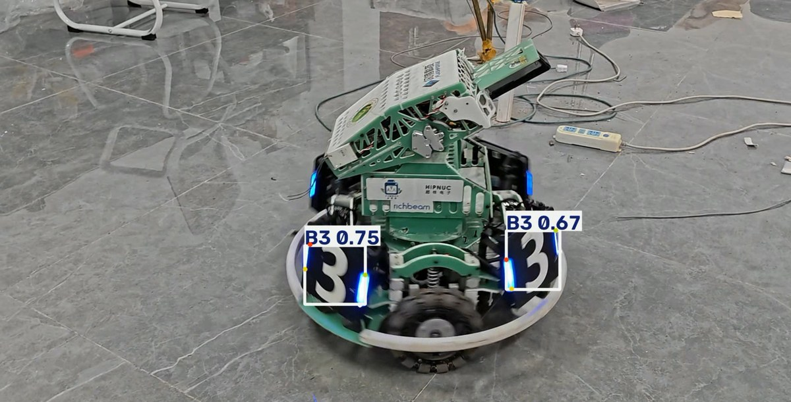
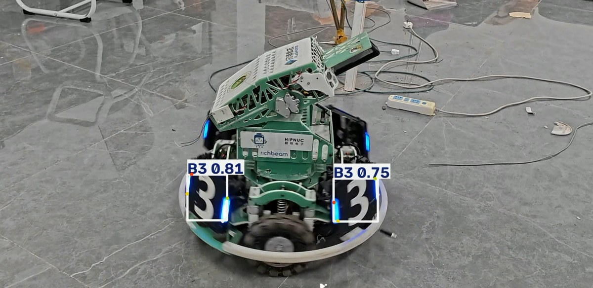
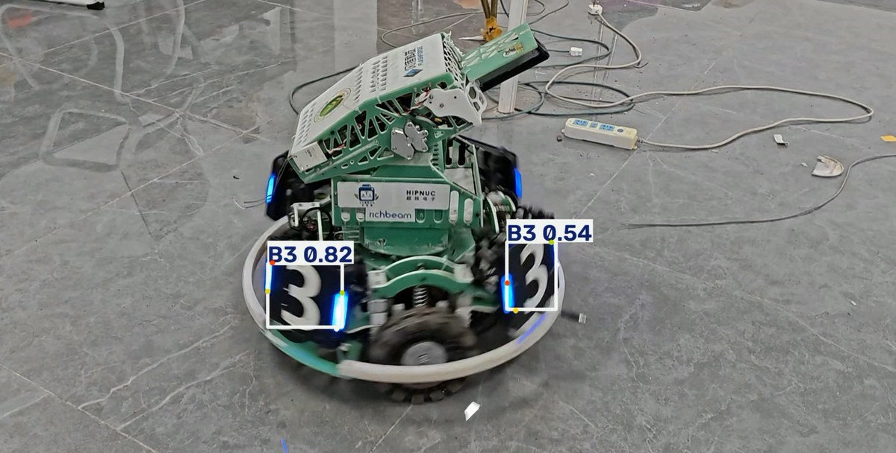

# YOLO 姿态估计装甲板推理与模型导出对比

基于 Ultralytics YOLO26n-pose 的装甲板检测与关键点提取项目，并将 `.pt` 模型导出为 `.onnx`、`.torchscript` 格式，对比三者的推理速度与输出一致性。

## 1. 项目功能

基于 YOLO 姿态估计模型，实现对视频中装甲板的检测与关键点提取。本次实验在此基础上，将原始 `.pt` 模型导出为 `.onnx` 与 `.torchscript` 格式，并对比三者的推理表现。

| 项目 | 说明 |
| :--- | :--- |
| 模型 | YOLO26n-pose（Ultralytics 8.4.177） |
| 任务 | pose：6 类装甲板，每个目标 4 个关键点 |
| 类别 | `B1`、`B2`、`B3`、`R1`、`R2`、`R3` |
| 模型输入 | 640 × 640 |
| 测试视频 | 1920 × 1080，30 FPS，620 帧（`data/test_video.mp4`，体积较大未入库） |

## 2. 运行环境

- Python 版本：Python 3.10.8
- 主要依赖：`torch`、`ultralytics`、`opencv-python`、`numpy`、`onnx`、`onnxruntime`（GPU 环境为 `onnxruntime-gpu`）、`onnxslim`
- 实验推理设备：NVIDIA RTX 5070 Laptop GPU

> **复现 GPU 结果前请确认：**
> 1. RTX 5070 需要 CUDA 12.8+ 与 PyTorch 2.7+；
> 2. ONNX 侧需要安装 `onnxruntime-gpu`，否则会退回 CPU 推理，和 GPU 上的 `.pt` 对比不公平；
> 3. Windows 上直接 `pip install torch` 默认安装的是 CPU 版，GPU 版请按 [PyTorch 官网](https://pytorch.org/get-started/locally/)给出的命令安装。

## 3. 权重准备

把训练好的 `best.pt` 放到 `weights/` 目录下，脚本按以下路径读取：

| 文件 | 说明 |
| :--- | :--- |
| `weights/best.pt` | 原始 PyTorch 权重 |
| `weights/best.onnx` | 由 `export.py` 导出 |
| `weights/best.torchscript` | 由 `export.py` 导出 |

三个权重文件均已提交到仓库。测试视频 `data/test_video.mp4` 因体积原因未提交，需要自行准备并放到 `data/` 目录下。

## 4. 模型导出说明

使用 Ultralytics 官方 API 进行导出（代码见 `export.py`）：

- **ONNX**：设置 `simplify=True`，opset 18，静态输入 `1×3×640×640`，输出 `1×18×8400`，通用性强。
- **TorchScript**：采用默认 Trace 方式导出，适合 C++ 等无 Python 环境部署。

```bash
python export.py
```

## 5. 安装与运行

1. 安装依赖：

```bash
pip install -r requirements.txt
```

2. 导出模型（仓库已包含导出结果，可跳过）：

```bash
python export.py
```

3. 运行推理与对比测试：

```bash
python compare_inference.py
```

4. 结果保存位置：
   - 对比视频：`results/result_pt.mp4`、`results/result_onnx.mp4`、`results/result_torchscript.mp4`
   - 统计结果：`results/metrics.json`
   - 对比截图：`assets/`

## 6. 模型对比结果

测试数据：`data/test_video.mp4`；视频分辨率 1920 × 1080，模型输入 640 × 640。

### 原始模型 (.pt) 效果



### ONNX 模型效果



### TorchScript 模型效果



| 对比项目 | 原始 .pt 模型 | ONNX 模型 | TorchScript 模型 |
| :--- | :--- | :--- | :--- |
| 模型文件大小 | 5.61 MB | 9.72 MB | 9.95 MB |
| 平均推理耗时 | 32.76 ms | 36.13 ms | 53.74 ms |
| 检测目标数量 | 2 | 2 | 2 |

### 6.1 实验现象

- **问题 1：第一次运行时，ONNX 格式慢于 PT 格式，很奇怪。**
  - **解决过程**：经过多次测试以后，取平均值得到 ONNX 依然略慢于 PT，TorchScript 最慢。

### 6.2 数值一致性

脚本会以 `.pt` 为基准，逐帧比较 ONNX / TorchScript 的检测框与关键点坐标，结果写入 `results/metrics.json`：

- ONNX 与 TorchScript 的输出几乎逐字节一致，两者生成的对比视频 SHA256 相同；
- 与 `.pt` 相比存在亚像素级差异，检测框偏差通常在 1 px 以内；
- 个别帧中目标置信度非常接近 0.25 阈值，会出现三种模型检出数量相差 1 个的情况。

## 7. 实验结论与分析

1. **速度差异**：在本次 GPU 测试环境下，ONNX 的推理速度略慢于原始 PyTorch 模型，TorchScript 速度最慢。
2. **原因分析**：桌面 GPU 上 PyTorch 技术更成熟，而 ONNX 在 GPU 上的速度优势不如 CPU 上明显。ONNX 的优势在于跨平台部署与 CPU 推理，而不是在 GPU 上追求速度。
3. **精度与效果**：三种模型输出的检测框和关键点连线在视觉上基本一致，模型转换未造成明显精度损失；逐帧坐标差异见 `results/metrics.json`。
4. **格式理解**：
   - `.pt` 包含完整的训练信息，体积小，速度较快，适合直接用 Python 继续研究和微调。
   - `.onnx` 采用通用计算图标准，解耦了深度学习框架，跨平台兼容性极强，且便于加速。
   - `.torchscript` 是 PyTorch 的原生部署格式，兼顾了 PyTorch 的易用性和 C++ 等底层语言的高效性，但速度较慢。