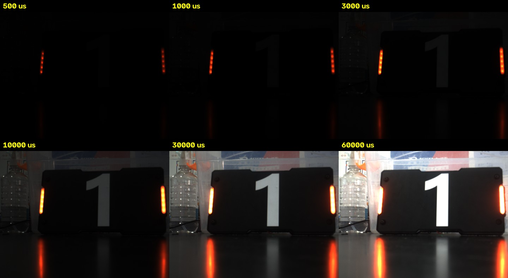
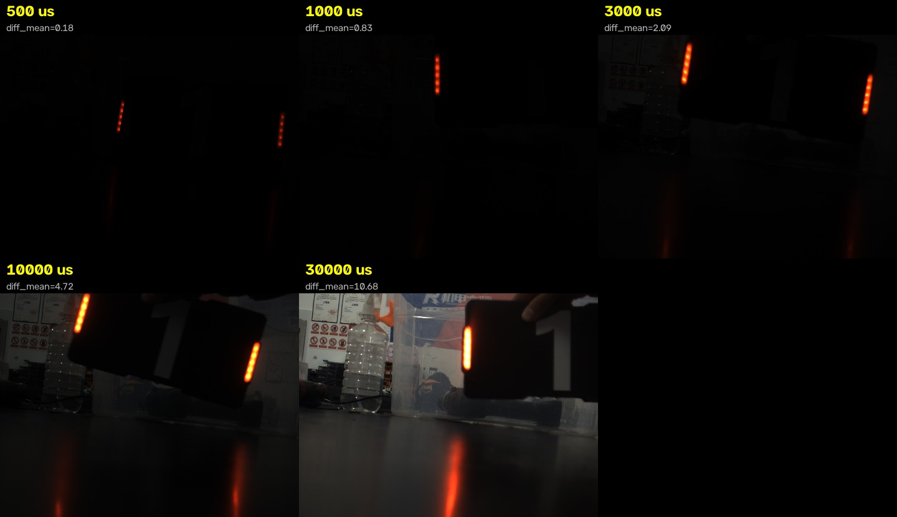
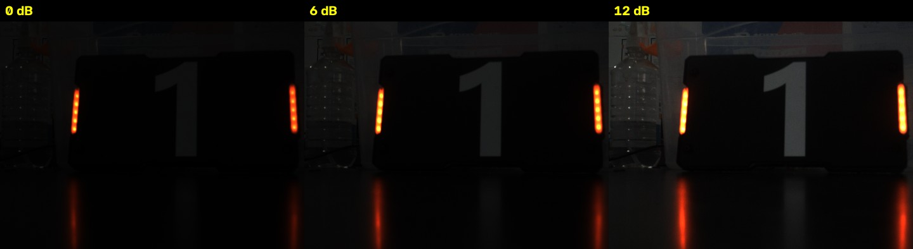
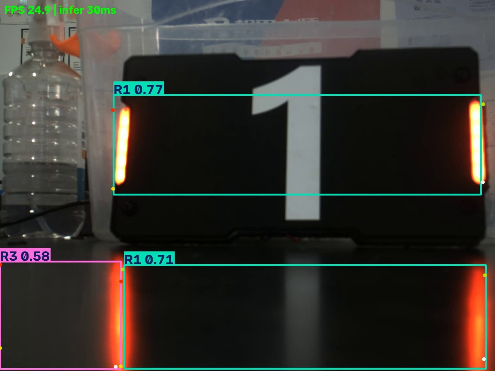
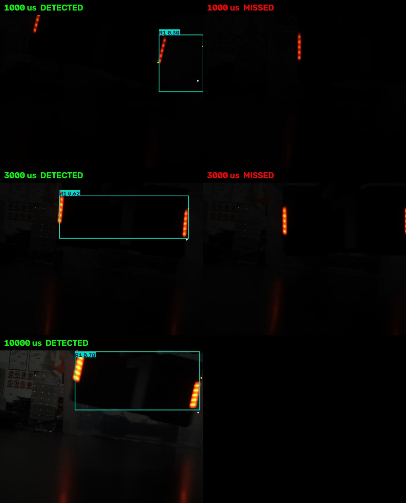

# 工业相机图像采集与 YOLO 实时识别 实验记录

## 0. 实验环境

| 项目 | 内容 |
|---|---|
| 相机型号 | HIKROBOT MV-CA016-10UC |
| 相机序列号 | 00L28498186 |
| 设备版本 | V1.6.3 201222 551351 |
| 固件版本 | V1.6.3 201222,20091101 |
| 原生分辨率 | 1440 × 1080 |
| 操作系统 | Ubuntu 22.04.5 LTS (kernel 6.8.0-138-generic)，VMware 虚拟机 8 vCPU / 6 GB |
| 相机 SDK | MVS Linux 版 4.9.0.3 (`/opt/MVS`) |
| 图像库 | OpenCV 5.0.0 (Python 3.10.12) |
| 推理库 | ultralytics 8.4.204，torch 2.14.1+cu130（CPU 推理） |
| 模型 | `weights/best.pt`，6 类：B1 B2 B3 R1 R2 R3 |
| 光源 | 室内照明 + 装甲板自带红色 LED 灯带 |
| 场景 | 1 号红色装甲板固定于黑色台面，背景为透明收纳箱、矿泉水瓶 |
| 采集默认参数 | BayerRG8 原生格式，曝光 3000 μs，增益 0 dB，帧率 30 fps |
| ROI | 全画幅 1440 × 1080，未做裁剪（OffsetX/Y 均为 0） |

相机通过 VMware USB 直通接入虚拟机（`usb.autoConnect.device0 = "0x2bdf:0x0001"`）。MVS 客户端以独占模式占用相机，因此运行程序前需要关闭 MVS 主程序。

## 1. 曝光时间对成像的影响（exp1）

固定相机、光源与增益（0 dB），改变曝光时间，每档采集 3 张原始图（PNG）。

| 曝光 (μs) | 平均亮度 | 99 分位 | 最大灰度 | 饱和像素占比 | 清晰度（Laplacian 方差） |
|---|---|---|---|---|---|
| 500 | 0.69 | 2 | 48 | 0.000 % | 0.4 |
| 1000 | 1.64 | 5 | 92 | 0.000 % | 0.8 |
| 3000 | 5.39 | 16 | 156 | 0.000 % | 1.9 |
| 10000 | 17.54 | 62 | 220 | 0.016 % | 3.7 |
| 30000 | 50.22 | 168 | 255 | 0.446 % | 9.0 |
| 60000 | 95.33 | 255 | 255 | 6.070 % | 16.9 |

观察：

- 平均亮度随曝光近似线性增长（0.69 → 95.33，约 138 倍），与光积分模型一致。
- 500 μs 画面几乎全黑（mean 0.69），看不清装甲板轮廓和数字；3000 μs 起可以辨认；本次场景下 30000 μs 比较合适。
- 清晰度指标随曝光单调上升，但饱和像素同时从 0 增加到 6.07 %，亮部细节开始丢失。
- 曝光时间就是单帧的光积分时长，物体在这段时间里移动的距离会叠加到同一帧上，形成拖影。按 1 m/s 横向移动估算，60000 μs 曝光对应 6 cm 模糊长度，500 μs 只有 0.05 cm。

### 1.1 运动拖影（exp1m）

手动让 1 号装甲板在相机前方左右横移（约 1~2 次/秒），程序按 500 / 1000 / 3000 / 10000 / 30000 μs 依次切换曝光，每档连续采集 8 秒（约 240 帧），并用帧间差异（相邻帧灰度差的均值）衡量运动强度。

| 曝光 (μs) | 帧数 | 平均帧间差异 | 拖影观察 |
|---|---|---|---|
| 500 | 240 | 0.18 | 画面几乎全黑，只能看到 LED 点阵 |
| 1000 | 240 | 0.83 | 装甲板轮廓极暗，勉强可辨 |
| 3000 | 239 | 2.09 | 轮廓与数字可辨，运动边缘开始发虚 |
| 10000 | 240 | 4.72 | 边缘出现明显重影，右侧 LED 有横向拖尾 |
| 30000 | 240 | 10.68 | 拖影最长，装甲板被拉宽，数字「1」边缘重影 |

观察：

- 拖影长度约等于目标速度乘曝光时间。装甲板以 1~2 个板宽/秒横移时，30 ms 曝光内目标已移动数十像素，边缘和数字会糊在一起。
- 500~1000 μs 档的问题不是拖影，而是进光量不足（平均亮度 0.7~1.6），画面接近全黑，短曝光无拖影的优势被欠曝抵消了。
- 3000 μs 是本次场景下亮度和拖影都比较合适的点；10000 μs 起拖影肉眼可见；30000 μs 拖影明显，运动目标的边缘已经难以识别。
- 拍运动目标时要先保证曝光足够，再在亮度允许的前提下缩短曝光时间。必须长曝光时，需要更高亮度的光源或适度加增益来补偿。

## 2. 增益对图像质量的影响（exp2）

固定曝光 3000 μs、位置与光源，改变增益，每档 3 张。

| 增益 (dB) | 平均亮度 | 饱和像素占比 | 暗部噪声标准差 |
|---|---|---|---|
| 0 | 5.39 | 0.000 % | 0.31 |
| 6 | 10.41 | 0.000 % | 0.42 |
| 12 | 20.26 | 0.028 % | 0.85 |

观察：

- 增益每提高 6 dB，亮度大约翻倍（5.39 → 10.41 → 20.26），符合 dB 的定义。
- 暗部噪声标准差从 0.31 升到 0.85（约 2.7 倍），信号放大的同时噪声也一起放大，信噪比没有改善。
- 12 dB 时开始出现饱和像素（0.028 %），亮部有丢失细节的风险。
- 增益让画面"看起来更亮"，但本质是放大模拟信号，对识别不一定有帮助。提高亮度优先用曝光和光圈。

## 3. 图像格式与取流性能（exp3）

对比 BayerRG8（原生）与两种 planar 格式，固定曝光 3000 μs、增益 0 dB，各采集 5 秒。

| 像素格式 | 实测 FPS | 转换耗时 (ms/帧) | 进程 CPU 占用 | 单帧原始字节 |
|---|---|---|---|---|
| BayerRG8 (0x01080009) | 30.00 | 0.11 | 35.3 % | 1.56 MB |
| BGR8_Planar (0x02180015) | 29.99 | 4.23 | 23.3 % | 4.67 MB |
| RGB8_Planar (0x02180014) | 29.99 | 6.02 | 59.2 % | 4.67 MB |

观察：

- 三种格式取流都稳定在 30 fps，瓶颈在相机曝光和传输侧，不在主机解码。
- BayerRG8 原始数据只有 BGR 的 1/3（1.56 MB vs 4.67 MB），USB 传输压力最小。
- Bayer 转 BGR 由 OpenCV 在 8 线程下完成，实测 0.10 ms/帧；planar 格式需要把 3 个平面重排成交错 BGR，transpose 约 4.4 ms/帧，慢了 40 倍。
- BayerRG8 是相机传感器的原始输出（单通道 8 位，带马赛克排列）；BGR8 是程序去马赛克之后得到的 3 通道图像，两者不是一回事。BGR8_Planar 虽然名字叫 BGR，但海康的三个平面实际按 R、G、B 顺序输出，读取时要反序。
- 颜色排列：海康标称的 `BayerRG8` 实际 CFA 排列是 BGGR。直接按 `COLOR_BayerRG2BGR` 转换会让红蓝互换（用红色 LED 标定，R/B = 0.86），改用 `cv2.COLOR_BayerBG2BGR` 后 R/B = 1.17，颜色正确。

## 4. 内存管理与程序异常退出（exp4）

| 场景 | 结果 |
|---|---|
| 正常取流 100 帧 | 全部成功；RSS 86.0 → 103.4 MB（+17.4 MB，numpy/OpenCV 缓冲），文件描述符 17 → 17 无泄漏 |
| 取流超时（未 StartGrabbing 直接 grab） | 10.3 ms 后返回 None，程序不崩溃 |
| 不支持的格式别名 | `CameraError: 不支持的格式别名 BGR8_Packed` |
| SDK 层非法 PixelFormat（0xDEADBEEF） | `MV_CC_SetEnumValue` 返回 0x80000101，设备拒绝写入 |
| 图像缓冲区不归还 | 第 2 次 `MV_CC_GetImageBuffer` 即返回 0x80000007 (MV_E_NORESOURCE)，等待 800 ms 超时；`stop/start` 后可恢复 |
| 采集过程中抛异常 | `with` 块内 RuntimeError 被捕获，`__exit__` 完成 CloseDevice/DestroyHandle，重新打开相机成功 |
| 最终进程状态 | `exit_ok = true`，RSS 78.9 MB，fd 18 |

观察：

- SDK 的图像缓冲区是有限资源，`MV_CC_GetImageBuffer` 和 `MV_CC_FreeImageBuffer` 必须成对调用。只取不还会立刻耗尽缓冲（0x80000007），表现为取流卡住或超时。
- 错误码 0x80000101 是参数非法，SDK 在设置阶段就拒绝了，不会影响后续状态。
- 取流超时返回 None 而不是抛异常，调用方必须判空。
- 用 `with` 上下文管理器保证异常路径上设备也被正确关闭，否则会出现"相机被占住、下次打不开"的情况。

完整日志见 `data/exp/exp4_error.log`，指标见 `data/exp/exp4_result.json`。

### 4.1 图像内存行为（exp4b）

课堂示例 `mat_memory` 未随资料提供，这里用等价脚本 `experiments/exp4b_mat_memory.py` 演示 OpenCV/NumPy 图像的内存分配与回收，单帧 1440×1080×3 约 4.67 MB。

| 步骤 | 进程 RSS |
|---|---|
| 起始 | 50.1 MB |
| 分配 1 帧 | 50.1 MB |
| 500 个浅引用（视图） | 50.1 MB |
| 20 个深拷贝（.copy()） | 139.3 MB |
| 20 个 cvtColor 灰度结果 | 170.4 MB |
| 删除深拷贝 + gc | 51.6 MB |
| 持有 100 帧（模拟泄漏） | 64.9 MB |
| 释放 100 帧 | 51.7 MB |
| 5 帧环形缓冲跑 300 次 | 78.3 MB |

观察：

- 浅拷贝（视图）只保存引用，内存不增加；深拷贝才真正分配，20 份约 89 MB，接近 20 × 4.67 MB。
- 删除引用并 gc 之后内存基本回到起始水平，说明正常释放是有效的。
- 持有 100 帧时 RSS 只涨了约 13 MB，少于理论值 467 MB。原因是 `np.zeros` 在 Linux 上用共享零页做延迟分配，只有真正写入的页才计入 RSS，这类"只看不写"的内存增长不能靠 RSS 发现，实际采集场景里帧数据会被写入，增长是实打实的。
- 环形缓冲（只保留最近 5 帧）跑 300 次，RSS 稳定在 78 MB 附近，没有随迭代次数增长。

## 5. YOLO 实时识别（exp5）

加载 `weights/best.pt`，相机实时取流 → 推理 → 画框、置信度、类别 → 录制视频。

| 指标 | 数值 |
|---|---|
| 首帧耗时（含模型加载/预热） | 2745.9 ms |
| 稳定后单帧推理 | 34.4 ms（采集循环内实测 31.1 ms） |
| 端到端帧率（采集+推理+绘制+录制） | 26.66 fps |
| 录制时长/帧数 | 15.08 s / 402 帧 |
| 输出视频 | `data/exp/exp5_demo.mp4`（4.9 MB） |
| 运动跟随演示 | `docs/video/exp5b_motion_demo.mp4`（552 帧 / 19.9 s / 9.1 MB） |

检测统计：

- `R1`：804 次，平均置信度 0.742（每帧 2 个框）
- `R3`：402 次，平均置信度 0.582（每帧 1 个框）

观察：

- 真实装甲板稳定检出为 R1，置信度约 0.74。每帧多出 1 个 R1 和 1 个 R3 属于误检。
- 抽帧确认，多出来的 R1 来自装甲板 LED 在黑色台面上的红色倒影，左侧 R3 来自画面边缘的杂物。高反光和倒影是这类误检的常见原因。
- 端到端 26.66 fps 基本满足实时（相机 30 fps），瓶颈在 CPU 推理，约 31 ms/帧。
- 演示视频见 [`docs/video/exp5_demo.mp4`](video/exp5_demo.mp4)。
- 另录了一段运动跟随视频（exp5b）：曝光 10000 μs，由手拿着装甲板在画面内左右移动约 15 秒。共 972 帧，每帧都检出 R1，平均置信度 0.839，端到端 27.74 fps。视频见 [`docs/video/exp5b_motion_demo.mp4`](video/exp5b_motion_demo.mp4)，截帧见 `images/exp5b_motion_frames.jpg`。

## 6. 相机参数对识别结果的影响（exp6）

用 exp1 / exp2 采集的原始图直接送 YOLO（conf=0.25），统计检测框数量和最高置信度。

曝光的影响：

| 曝光 (μs) | 平均亮度 | 检测框数 | 最高置信度 | 顶类别 |
|---|---|---|---|---|
| 500 | 0.67 | 0 | — | 未识别 |
| 1000 | 1.61 | 2 | 0.622 | R1 |
| 3000 | 5.42 | 1 | 0.757 | R1 |
| 10000 | 17.71 | 2 | 0.773 | R1 |
| 30000 | 50.51 | 3 | 0.772 | R1 |
| 60000 | 95.86 | 3 | 0.777 | R1 |

增益的影响：

| 增益 (dB) | 平均亮度 | 检测框数 | 最高置信度 | 顶类别 |
|---|---|---|---|---|
| 0 | 5.42 | 1 | 0.757 | R1 |
| 6 | 10.53 | 1 | 0.768 | R1 |
| 12 | 20.46 | 2 | 0.774 | R1 |

观察：

- 异常案例：500 μs（mean 0.67，几乎全黑）时 0 个检测框，完全失效。这是欠曝光最严重的后果。
- 临界案例：1000 μs 仍能检出 R1，但置信度降到 0.622，并出现 2 个框（开始误检）。
- 正常案例：30000 μs 时 R1 置信度 0.772；60000 μs 虽然已有 6 % 饱和，识别仍稳定（0.777），因为黑色板体和红色 LED 的对比依然明显。
- 增益从 0 到 12 dB，置信度只从 0.757 升到 0.774，但噪声上升、多出 1 个误检框。变亮不等于更好识别。
- 误检数和画面亮度正相关（30000/60000 μs 都是 3 个框），和第 5 节的倒影误检一致：亮度越高，桌面反光越容易被当成装甲板。

### 6.1 运动状态下的识别（exp6b）

对 exp1m 的 5 档运动帧（每档 8 帧，先用红色 LED 亮斑筛掉装甲板不在画面内的帧）做 YOLO 推理，统计 R1 检出率和置信度。脚本 `experiments/exp6b_motion_yolo.py`，结果 `data/exp/exp6b_motion_yolo.json`。

| 曝光 (μs) | 可见帧 | R1 检出率 | 平均框数 | R1 平均置信度 |
|---|---|---|---|---|
| 500 | 0/8 | — | — | — |
| 1000 | 8/8 | 38 % | 0.38 | 0.317 |
| 3000 | 8/8 | 62 % | 1.25 | 0.470 |
| 10000 | 8/8 | 100 % | 1.00 | 0.800 |
| 30000 | 8/8 | 100 % | 1.00 | 0.784 |

观察：

- 500 μs 档红色 LED 的亮度都不足以触发可见性阈值，完全失效；1000 μs 起装甲板可见，但置信度只有 0.317。
- 同一曝光下对比运动和静止：3000 μs 静止时 R1 置信度 0.757（3/3 检出），运动时降到 0.470、检出率 62 %。拖影确实让识别质量下降，漏检集中在装甲板位于画面边缘、形变最大的帧。
- 10000 / 30000 μs 档检出率反而是 100 %。这两档亮度充足（mean 17.7 / 50.5），YOLO 主要靠"黑色板体 + 两侧红色 LED"的整体结构，本次甩动速度（约 1~2 板宽/秒）的拖影还没有破坏这个结构。
- 所以本场景下亮度是识别成败的第一因素，拖影是第二因素：曝光不足时（≤1000 μs）静止也识别不了；亮度足够后，适度拖影还能容忍。
- 要复现"运动模糊导致识别失败"，需要更快的速度或更长的曝光。按 30 ms 曝光粗估，目标速度超过约 4~5 板宽/秒（≈1 m/s）时 LED 会拖成连续光带、板体轮廓消失，识别率会明显下降。本次手动甩动没到这个速度。
- 每档只有 8 帧，结论是趋势性的，统计精度有限。

## 7. 未完成的部分

1. 运动目标的速度靠手动甩动，没有可标定的速度基准，拖影只能做定性对比，给不出"拖影像素数 = 速度 × 曝光"的定量曲线。
2. `best.onnx` 和 `best.torchscript` 的推理速度没有测。虚拟机离线，缺 `onnxruntime`，装上之后可以直接补测。
3. 曝光超过 33333 μs 时帧周期会被曝光本身限制（60000 μs 理论上限约 16.7 fps），本次没有单独测量各曝光下的端到端帧率。
4. 增益只测到 12 dB，相机上限是 17.02 dB，更高增益噪声增长过快，对本场景没有实用价值。
5. 实验在室内常态照明下完成，3000 μs 下平均亮度只有 5.4，偏暗。加主动光源后短曝光档的可用性会明显改善。
